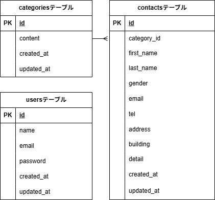

# coachtech お問い合わせフォーム

## 環境構築

### Dockerビルド

```bash
git clone git@github.com:takeotaira/confirm-test-contact-form.git
cd confirm-test-contact-form
docker compose up -d --build
```

※ SSHでcloneできない場合は以下を使用してください。

```bash
git clone https://github.com/takeotaira/confirm-test-contact-form.git
cd confirm-test-contact-form
docker compose up -d --build
```

### Laravel環境構築

```bash
docker compose exec php bash
composer install
cp .env.example .env
php artisan key:generate
chmod -R 777 storage bootstrap/cache
php artisan migrate:fresh --seed
```

### .envのDB設定

```env
DB_CONNECTION=mysql
DB_HOST=mysql
DB_PORT=3306
DB_DATABASE=laravel_db
DB_USERNAME=laravel_user
DB_PASSWORD=laravel_pass
```

## ログイン情報

- メールアドレス: test@example.com
- パスワード: password

## 実装機能

- お問い合わせフォーム機能
- 管理画面機能
- ユーザー認証機能
- CSVエクスポート機能

## 使用技術

- PHP
- Laravel
- MySQL
- Docker

## ER図



## URL

- 開発環境: http://localhost/
- phpMyAdmin: http://localhost:8080/